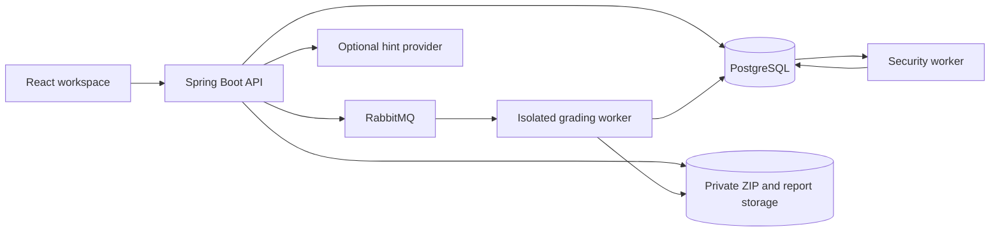
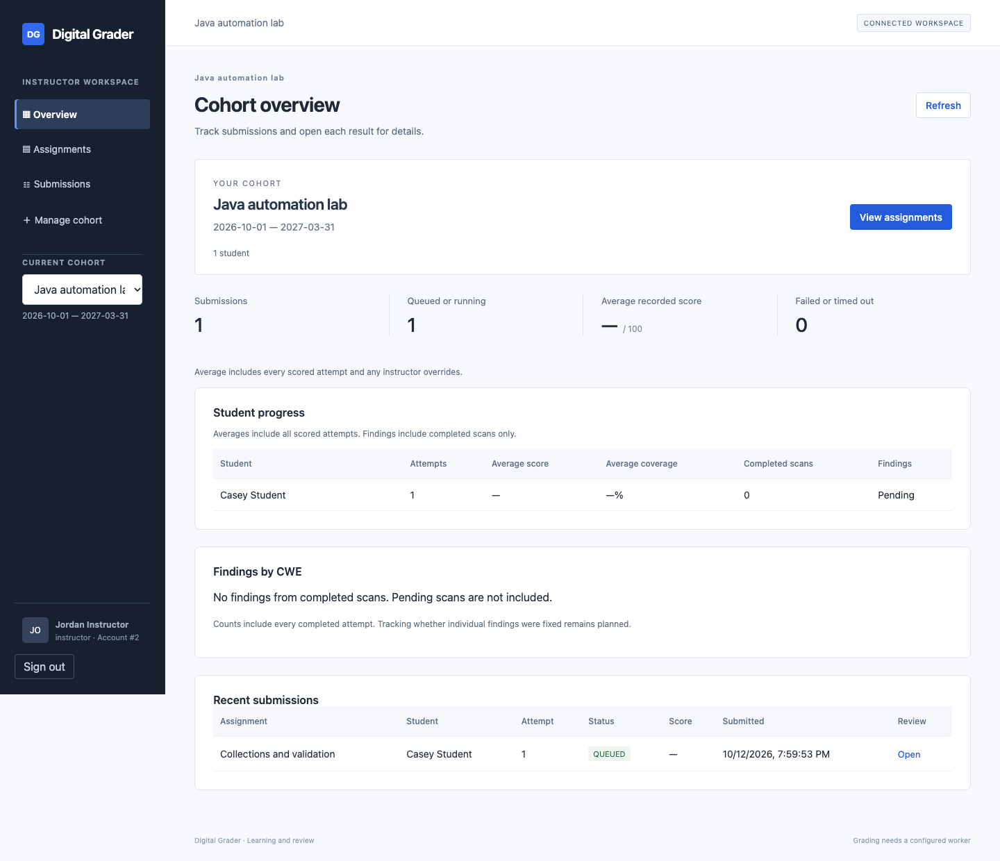
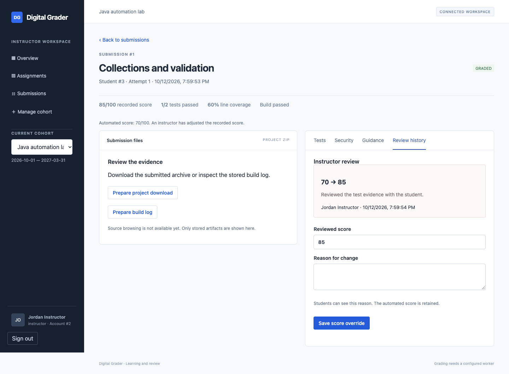

# Digital Grader

## Project overview and development report

Digital Grader is a learning and review platform for Java test automation assignments. It is an independent project for Mindtek, designed to give instructors a consistent place to review submissions and help students understand their next steps.

**The main idea:** students submit a Maven project; background workers evaluate it; instructors review the evidence and can adjust a score with a written reason.

## The problem

Reviewing programming assignments involves several separate tasks: collecting files, running tests, reading reports, checking security issues, and explaining what to improve. Digital Grader brings these tasks into one workflow while keeping instructors responsible for the final assessment.

## Who uses it

| User | Main activities |
|---|---|
| Student | View assignments, upload a project, follow grading status, read results and guidance |
| Instructor | Create cohorts, enroll students, set assignments, inspect submissions and record score changes |
| Administrator | Provision instructor accounts and manage access through the API |

## How it works

1. An instructor creates a cohort and an assignment with a deadline, attempt limit, and grading rubric.
2. An enrolled student uploads a ZIP containing a Maven project.
3. The API validates the archive, stores it privately, and queues the submission.
4. A grading worker is designed to run the project inside a restricted Linux sandbox and record tests, coverage, quality checks, and a score.
5. A security worker checks the project and records findings separately from its grade.
6. The student and instructor read the results. Optional model guidance explains possible next steps.
7. An instructor can save a score override with a reason. The automated score and review history remain available.

## System design

The frontend uses React and TypeScript. The backend uses Java 17 and Spring Boot. PostgreSQL stores accounts, assignments, results, and review history. MinIO holds uploaded files and reports. RabbitMQ delivers grading jobs. Grading and security workers require gVisor on Linux.

## Current development status

Sessions 1–5 established the prototype, repository, authentication, classroom APIs, and submission storage. Sessions 6–7 added grading, security scanning, and optional tutoring hints. Session 8 connects the browser workspace to the API and adds persistent instructor reviews.

The connected interface supports registration, sign-in, cohort setup, enrollment, assignments, uploads, submission lists, score and coverage trends, cohort summaries, security counts, result views, and score overrides. A separate demo area contains labeled sample content.

Local backend and frontend tests verify access rules, data handling, error states, and review behavior. A browser test uses disposable services for classroom setup and uploads. Stored report fixtures are used to check result rendering and score overrides; these fixtures do not demonstrate real grading execution.

## Interface examples

Teacher overview after a real upload in the disposable test environment. Names and assignments are fictional.

Review workbench with stored report fixtures and an instructor score change. This illustrates the interface and audit history, not verified sandbox execution.

## What is still being verified

The complete grading and security flow has not yet passed acceptance testing on Ubuntu with gVisor. A current vulnerability database and a live hint provider also require verification. Source browsing, account recovery, deployment hardening, and large cohort performance remain release work.

This is a development prototype, not a production assessment system. No measured time savings, grading accuracy, or security assurance is claimed yet. An instructor controlled test harness and further evaluation are required before scores can be treated as authoritative.

## Suggested presentation

Start with the problem and the workflow above. Show cohort setup, assignment creation, a student upload, and the teacher submission list. Then show the review workbench using clearly identified report fixtures. Finish with the architecture and remaining acceptance work.

See [Session 8](SESSION_8.md) for verification details and [project status](HANDOFF.md) for the latest checkpoint.
